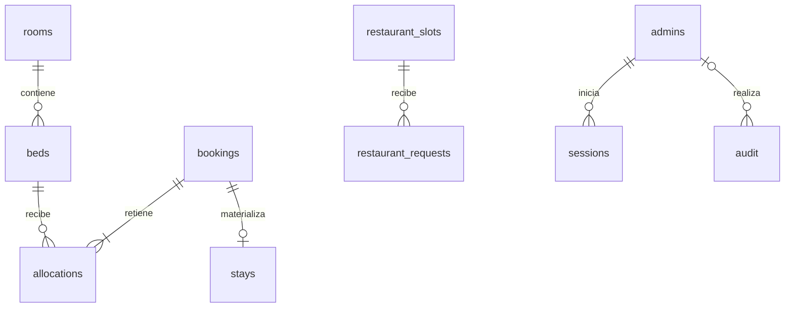

# Arquitectura y decisiones

## Fuente y stack

El destino autorizado por Diego es PruebaProyecto. Se inspeccionó vacío; la documentación del repositorio original no estaba accesible. Las decisiones de este repositorio no se presentan como decisiones aprobadas por el equipo original.

Se elige Node.js con módulos nativos y `pg`, frontend HTML/CSS/JS y PostgreSQL. Es un monolito modular: un proceso HTTP, una base de datos y un único origen. Reduce dependencias y facilita su explicación en DAW. Otra opción razonable era Spring Boot, pero no había código Java ni framework aprobado que conservar.

## Modelo

- `rooms`: datos descriptivos y estado. Capacidad calculada a partir de sus camas activas, sin duplicar un contador susceptible de desincronización.
- `beds`: identidad permanente. La reducción de capacidad desactiva camas, no las borra.
- `bookings`: solicitud y contacto mínimo, modalidad, personas, fechas, estado y referencia aleatoria. Se evita otra tabla llamada prereserva que duplicaría el mismo concepto.
- `allocations`: asignación histórica de cada cama a un rango. Una fila sin solicitud corresponde a un bloqueo administrativo con motivo. Al modificar/rechazar se conservan las filas y se desactivan.
- `stays`: se crea al aceptar, con timestamps de aceptación y entrada/salida reales. El check-out no libera anticipadamente noches contratadas.
- `restaurant_slots`: fecha, hora local, capacidad y cierre; `restaurant_requests` mantiene el consumo de plazas según estado.
- `idempotency`: clave UUID, huella de petición y respuesta pública mínima. No guarda el formulario ni contactos en el JSON de respuesta.
- `audit`: actor cuando corresponde, acción, referencia interna, fecha y cambios relevantes de inventario, sin copiar contactos.

## Alojamiento: intervalos y concurrencia

Las fechas son `date`, expresadas `YYYY-MM-DD` en la API, con intervalos `[entrada,salida)`. La noche de salida no se ocupa. Se permiten intervalos contiguos. Se valida fecha real, llegada no pasada, salida posterior y un máximo de 366 noches por petición. El día operativo se calcula en `Europe/Madrid`.

Todas las mutaciones de inventario usan una transacción y el mismo bloqueo asesor PostgreSQL `741002`. En este primer incremento se serializa el inventario del albergue entero: es conservador y adecuado a su escala; simplifica el orden de locks y el conflicto entre habitación completa y camas sueltas. No es una arquitectura para miles de reservas por segundo.

Además, `allocations` incluye una restricción de exclusión GiST `(bed_id WITH =, period WITH &&) WHERE(active)`. PostgreSQL impide un solapamiento activo incluso si una ruta futura olvidase el bloqueo asesor. La extensión `btree_gist` proporciona igualdad GiST para el ID de cama.

1. Iniciar transacción y bloquear clave de idempotencia.
2. Si existe la clave, comprobar huella y devolver la misma referencia, o conflicto si cambió la petición.
3. Bloquear inventario, validar camas activas y capacidad.
4. Insertar solicitud, asignaciones y auditoría; almacenar resultado idempotente.
5. Commit completo. Un conflicto revierte todo y se convierte en HTTP 409.

Aceptar crea `stays` y cambia estado dentro de una única transacción, sin eliminar asignaciones. Rechazar desactiva asignaciones y conserva el historial. Modificar desactiva las asignaciones anteriores e intenta insertar las nuevas dentro de la misma transacción; si falla, el rollback conserva las anteriores. Los lectores externos no ven un estado intermedio.

Una solicitud resuelta no puede pasar otra vez de aceptada a rechazada. No se implementa cancelación de reservas aceptadas en este incremento. Las pendientes no caducan automáticamente.

Los cambios de capacidad no reescriben asignaciones históricas. Se impide reducir/desactivar recursos con asignaciones activas que acaben después de hoy. Añadir camas no las incorpora retroactivamente a una reserva antigua de habitación completa: el conjunto solicitado queda congelado en sus asignaciones. Es una decisión que el equipo debe revisar si quiere una regla de exclusividad sobre futuras ampliaciones de habitación.

## Restaurante

Cada solicitud bloquea la fila del turno mediante `SELECT ... FOR UPDATE`, calcula consumo de solicitudes pendientes y aceptadas y comprueba el aforo. La suma y la inserción ocurren en la misma transacción. Las resoluciones toman el mismo lock de turno antes de cambiar consumo. No hay asignación de mesas físicas.

Una aceptación no cambia el consumo. Un rechazo lo libera. No se permite cerrar, mover fecha/hora o reducir capacidad por debajo del consumo de un turno con solicitudes vigentes. No se generan horarios ni aforos ficticios mediante el seed.

## Límites conocidos

El panel recibe las 500 solicitudes y turnos más recientes. El planning se calcula desde ese conjunto y no debe usarse para explotación masiva: pendiente endpoint paginado por rango y recursos. La disponibilidad pública y las garantías del servidor sí consultan el inventario completo.

Rol único de administrador. La edición individual de cama, fotografías, configuración de contenido, notificaciones, modificación de solicitudes de restaurante, roles diferenciados y cancelaciones quedan para siguientes incrementos. La vista de 31 días es un planning continuo, no una cuadrícula de mes natural.
